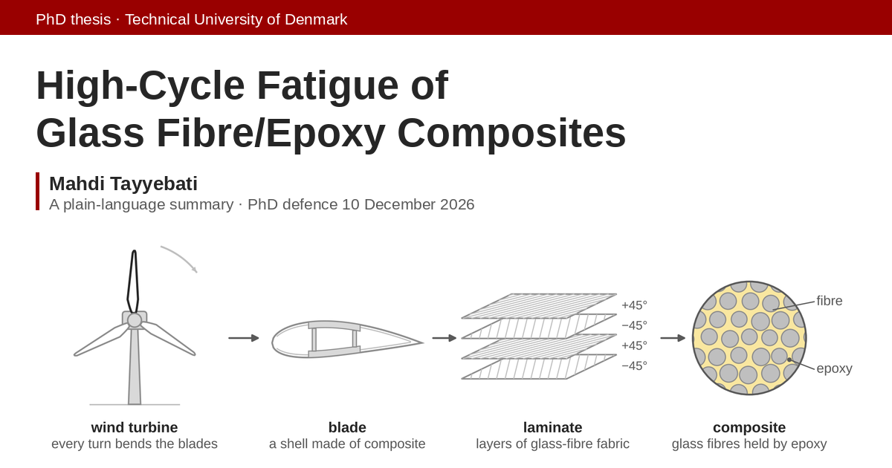

# Popular science summary web page

The plain-language summary of the PhD thesis *High-Cycle Fatigue of Glass Fibre/Epoxy Composites* (Mahdi Tayyebati, Technical University of Denmark), published at https://mahditbt.github.io/phd-summary/.

- `index.html`: the page.
- `*.gif`: the animations, drawn in the style of the defence presentation (Python and matplotlib). The turbine and the laminate-damage animations are rendered again from the presentation's own scripts; the others were made for this page. Files ending in `-phone` are the versions shown on narrow screens.
- `*.png`: a still of each animation, shown to readers whose device asks for reduced motion.
- `phd-defence.ics`: the calendar entry behind "Add to calendar".
- `preview.png`: the picture shown when the link is shared.

To change the text, edit `index.html` on GitHub; the site updates within about a minute.
